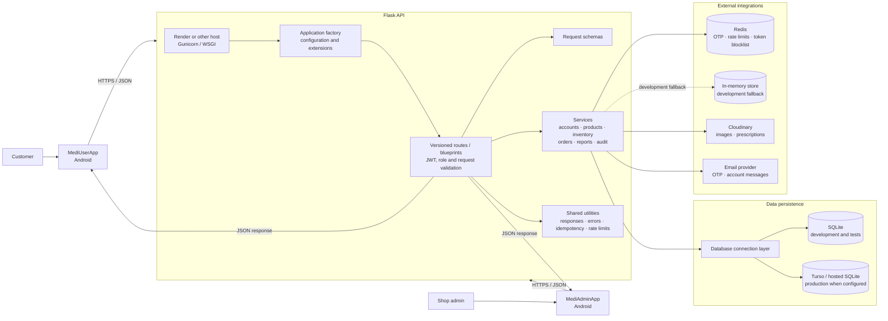
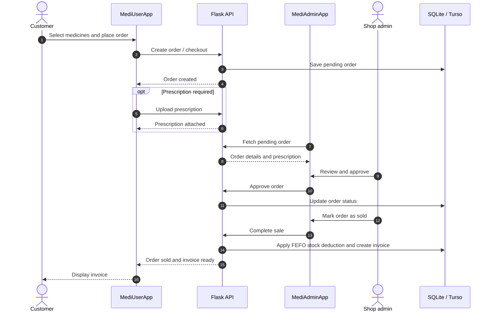
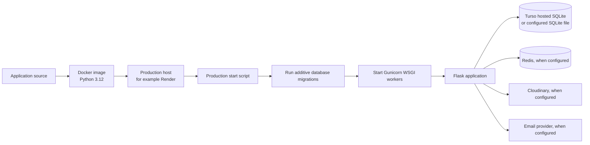

# Medi Manage API — Architecture

This document describes the runtime architecture of the pharmacy management API. The diagrams use Mermaid and render directly on GitHub.

## System architecture

## Request and order flow

## Deployment architecture

## Component responsibilities

- **Routes and blueprints** handle HTTP concerns, authentication and authorization checks, request validation, and response formatting.
- **Schemas and utilities** provide shared input validation, standard JSON responses, error handling, idempotency, and rate limiting.
- **Services** implement pharmacy workflows, including FEFO inventory deductions and order processing.
- **Database layer** provides the configured SQLite/Turso access. Related stock and order updates are performed transactionally.
- **Integrations** provide OTP/token storage, media uploads, and transactional email, selected through environment configuration.
- **Production startup** runs database migrations before starting the Gunicorn WSGI server.

For setup, configuration, and testing details, see [README.md](README.md).
