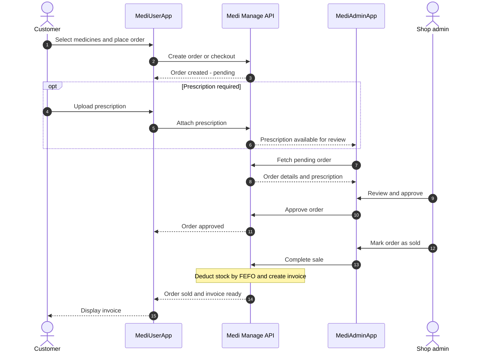
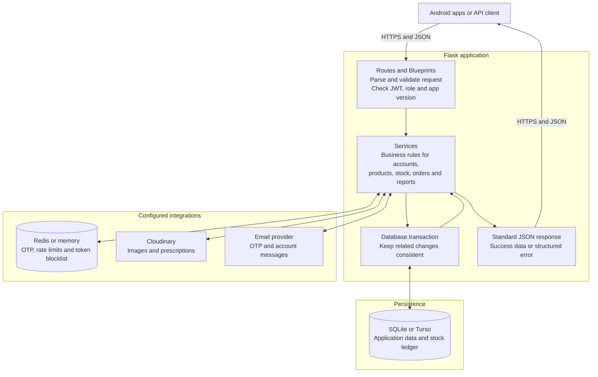

# Medi Manage API

REST API for a medical shop (pharmacy). It powers two Android apps: **MediUserApp** for customers and **MediAdminApp** for the shop owner. It covers accounts, products, batch-wise inventory, orders, invoices, prescriptions and reports.

<p>
  
  
  
  
  
  
  
  
  
  
  
</p>

---

## Contents

- [Features](#features)
- [Tech stack](#tech-stack)
- [How it works](#how-it-works)
- [Project structure](#project-structure)
- [Getting started](#getting-started)
- [Configuration](#configuration)
- [Database](#database)
- [Deployment](#deployment)
- [Security](#security)
- [Testing](#testing)
- [Error format](#error-format)
- [Related projects](#related-projects)
- [Contributing](#contributing)
- [License](#license)

---

## Features

**Accounts and authentication**
- Separate `user` (customer) and `admin` (shop) accounts with role-based access.
- Sign in with email and password, then a 6-digit email OTP. JWT access and refresh tokens, logout revokes the token.
- Email verification on sign up, password reset by OTP, resend with cooldown.
- New accounts need approval. Admins can approve, block, unblock and remove accounts.

**Products and inventory**
- Product catalogue with categories, barcode lookup, search, filters, sorting and pagination.
- Batch-wise stock (batch number, MFG and expiry date, MRP, purchase price, supplier).
- Stock is sold **First-Expiry-First-Out (FEFO)**. Every change is recorded in a stock movement ledger.
- Stock purchase, adjustment and expired write-off. Low-stock, out-of-stock, near-expiry and expired lists.
- Supplier management.

**Orders and sales**
- Single orders and multi-product checkouts (one checkout, one invoice).
- Prescription upload for Rx and scheduled medicines, verified by the admin before the sale.
- Order lifecycle: `pending` → `approved` → `sold`, plus `cancelled` and `returned`.
- Invoices for orders and checkouts, sales history.

**Reports and admin tools**
- Dashboard summary, sales report, top products and audit log of admin actions.

**Platform**
- Versioned REST API with a single JSON response and error format.
- Retry-safe `POST` requests with the `Idempotency-Key` header.
- Minimum app version check with the `X-App-Version` header.
- Device registration for push notifications.
- OpenAPI 3.0 spec and Swagger UI (can be turned off in production).
- Health and readiness endpoints.

---

## Tech stack

| | Tool | Used for |
|---|---|---|
|  | **Python 3.12** | Language |
|  | **Flask 3.1** | Web framework, blueprints, application factory |
|  | **Flask-JWT-Extended** | Access and refresh tokens, token revocation |
|  | **SQLite** | Local database (development and tests) |
|  | **Turso (libSQL)** | Hosted SQLite in production, through a built-in HTTP client |
|  | **Redis** | OTP store, rate limiting, token blocklist |
|  | **Cloudinary** | Product images, profile photos and prescriptions |
|  | **Brevo / Resend** | Transactional email over HTTPS API (SMTP also supported) |
|  | **Gunicorn** | Production WSGI server |
|  | **Docker** | Container image and local compose setup |
|  | **Render** | Hosting |
|  | **OpenAPI / Swagger UI** | API documentation |
|  | **pytest** | Automated tests |

Other libraries: Flask-CORS, Werkzeug (password hashing), python-dotenv, aiosmtpd (local email debugging).

---

## How it works

The customer app and shop app use the same API, but perform different parts of the order workflow. The customer places an order and can attach a prescription; the shop reviews it, approves the order, and completes the sale. Inventory is then deducted using FEFO and the customer can view the invoice.



### Request flow inside the API

Each request passes through clear layers. The route handles HTTP concerns and access checks; the service applies pharmacy rules and coordinates data changes; the configured database and integrations handle persistence and external services.



- **Routes** validate input, check the JWT and role, and return the standard response.
- **Services** contain the business rules. Stock and order changes run in a database transaction, so related updates succeed or roll back together.
- **Integrations** (email, OTP store and file uploads) are selected by configuration, with separate development and production providers.

---

## Project structure

```
├── app/
│   ├── routes/          # Blueprints: auth, users, admins, products, inventory, orders, reports, ...
│   ├── services/        # Business logic: accounts, stock (FEFO), orders, reports, audit, DB setup
│   ├── integrations/    # Email (dev SMTP / production SMTP or API) and OTP store (memory / Redis)
│   ├── openapi/         # OpenAPI 3.0 spec
│   ├── utils/           # Validation, responses, idempotency, rate limit, time helpers
│   ├── db.py            # Database connections (SQLite or Turso)
│   └── turso_http.py    # Turso HTTP client with a sqlite3-style interface
├── config/              # Development, testing and production settings
├── scripts/
│   ├── dev/             # Local run helpers and a Turso connection check
│   └── prod/            # Container start: database migration, then Gunicorn
├── tests/               # pytest suite
├── requirements/        # base, dev and prod dependencies
├── Dockerfile
├── docker-compose.yml
└── wsgi.py              # WSGI entry point
```

---

## Getting started

**Requirements:** Python 3.12 or newer and Git. Redis and Docker are not needed for local development.

1. Clone and enter the project:
   ```bash
   git clone https://github.com/It-Saurabh001/Medi_Manage_Api.git
   cd Medi_Manage_Api
   ```

2. Create a virtual environment and install the development dependencies:
   ```bash
   python -m venv .venv
   .venv\Scripts\activate          # Windows
   # source .venv/bin/activate     # macOS / Linux
   pip install -r requirements/dev.txt
   ```

3. Create your local settings file from the example, then fill in your own Cloudinary values:
   ```bash
   copy .env.example .env          # Windows
   # cp .env.example .env          # macOS / Linux
   ```
   `.env` is ignored by Git. Keep real keys only there, never in `.env.example`.

4. Start the local email debug server in a separate terminal. OTP emails are printed there instead of being sent:
   ```bash
   start_mail.bat
   ```

5. Start the API. This creates or upgrades the tables, then runs the development server on port 5000:
   ```bash
   devstart.bat
   ```
   On macOS or Linux:
   ```bash
   export FLASK_ENV=development
   flask --app wsgi init-db
   flask --app wsgi run --debug
   ```
   Without `FLASK_ENV=development` the app starts in production mode and refuses to run until the production settings are present.

---

## Configuration

All settings come from environment variables: a local `.env` file in development, and the host's environment settings in production. They cover the app and JWT secrets, the database, Redis, Cloudinary and email providers.

| File | Purpose | Commit it? |
|---|---|---|
| `.env.example` | Local development template | Yes (placeholders only) |
| `.env.production.example` | Production template, names without values | Yes (no values) |
| `.env`, `.env.production` | Your real settings | **Never** |

Production refuses to start when a required setting is missing, a development provider is configured, or a signing key is one published in this repository.

Generate each secret separately (`SECRET_KEY`, `JWT_SECRET_KEY`, `ORIGIN_AUTH_SECRET`, `REDIS_PASSWORD`, `ADMIN_SIGNUP_CODE`):
```bash
python -c "import secrets; print(secrets.token_urlsafe(48))"
```
Use at least 32 characters, and a different value for every setting. Changing `JWT_SECRET_KEY` signs everyone out once.

---

## Database

| Environment | Database |
|---|---|
| Development and tests | Local SQLite file |
| Production | **Turso** (hosted SQLite), when configured |

- The same SQL runs on both. Turso is reached through a small built-in HTTP client, so no native driver is needed.
- Schema changes are additive and idempotent: tables, columns and indexes are created when missing, and existing data is never dropped.
- Without Turso, production falls back to a local SQLite file. On hosts with temporary disks that data is lost on restart, so use Turso or a persistent disk.

To check a Turso database before deploying (read-only):
```bash
python scripts/dev/check_turso.py
```
It reads the Turso settings from the environment.

---

## Deployment

The `Dockerfile` builds a production image (Python 3.12, non-root user, health check). On start, `scripts/prod/start.sh`:

1. runs the database migration once, in its own process;
2. starts Gunicorn (`WORKERS` and `BIND` can be set by environment).

Before deploying, set these in the host's environment settings (for example Render):

- `FLASK_ENV=production`
- `SECRET_KEY` and `JWT_SECRET_KEY`: long random values, not the ones in `.env.example`
- `ADMIN_SIGNUP_CODE`, or `BOOTSTRAP_ADMIN_EMAIL` and `BOOTSTRAP_ADMIN_PASSWORD`, to create the first owner admin (remove the bootstrap variables afterwards)
- The Redis, Cloudinary, email and database settings listed in `.env.production.example`

### Docker (optional)

Docker packages the API with everything it needs, and Compose runs it together with Redis. It is useful on your own server or to test a production-like setup locally. It is not needed for local development or for a host that runs Python directly.

1. Install Docker Desktop (or Docker Engine with Compose).
2. Copy `.env.production.example` to `.env.production` and fill it in. Both Redis lines must carry the same password:
   ```env
   REDIS_PASSWORD=<your-random-password>
   REDIS_URL=redis://:<your-random-password>@redis:6379/0
   ```
3. Start and stop the stack:
   ```bash
   docker compose --env-file .env.production up --build
   docker compose --env-file .env.production down
   ```

`--env-file` is required so Compose can read `REDIS_PASSWORD`. Redis is reachable only by the API container. The API listens on `http://localhost:5000`.

---

## Security

Built in, on by default:

- **Auth abuse limits.** These cover login, OTP verify/resend and password reset. Each endpoint is limited per IP and per target account. Each account also has an OTP-attempt budget that a new code doesn't reset, and reset codes are re-sent at most once a minute (silently). Signup is limited per IP.
- **Immediate session revocation.** Blocking, deleting or disabling an account, or resetting its password, invalidates all of its tokens at once. Clients get the codes they already handle: `ACCOUNT_BLOCKED`, `UNAUTHORIZED` or `TOKEN_INVALID`.
- **Customer data ownership.** Admins can approve, block, unblock and delete customers, but cannot edit their personal details (`PATCH /users/{user_id}` returns `403`).
- **Fail-closed configuration.** An unset `FLASK_ENV` means production. Production refuses to start with signing keys that are published in this repo. On an empty database, the owner can only be claimed with a signup code or `BOOTSTRAP_ADMIN_*`.
- **Edge guard** ([app/edge_guard.py](app/edge_guard.py)). This is in-app filtering modelled on Cloudflare: IP allow/block lists, an origin lock, scanner User-Agents, probe paths (`/.env`, `/.git`, `wp-admin`, ...), SQLi/XSS/traversal/Log4Shell signatures in the URL and selected headers, a URL-length limit and a global per-IP rate limit. Blocks are logged as `security-event rule=...`.
- **Security headers** on every response: `nosniff`, `X-Frame-Options`, CSP, `Referrer-Policy`, HSTS in production, and `Cache-Control: no-store` on API responses.

Opt-in. These change client-visible behaviour, so enable each one once the app supports it:

| Variable | Effect |
|---|---|
| `REQUIRE_USER_EMAIL_VERIFICATION=true` | Customers confirm their email (signup returns `otp_required`; verify with `POST /auth/verify-otp {email, otp, account_type:"user"}`) before logging in |
| `ADMIN_MANAGEMENT_OWNER_ONLY=true` | Only the owner admin can create, approve, disable or delete other admins |
| `PRESCRIPTION_PRIVATE_STORAGE=true` | Prescriptions become private Cloudinary assets; `prescription_url` is a signed URL that expires (do not cache it) |
| `ALLOWED_PRESCRIPTION_URL_HOSTS=res.cloudinary.com` | Client-supplied `prescription_url` must be `https` on these hosts |
| `BLOCK_EMPTY_USER_AGENT=true` | Rejects requests without a User-Agent |

### Behind Cloudflare

1. **Lock the origin.** Create a long random secret and set `ORIGIN_AUTH_SECRET` to it. In Cloudflare go to *Rules → Transform Rules → Modify Request Header* and *Set static* `X-Origin-Auth: <secret>` for the API hostname. Requests that bypass Cloudflare then get `403 ORIGIN_FORBIDDEN` (`/health` stays open for the host's health checks).
2. **Real client IPs.** Set `CLIENT_IP_HEADER=CF-Connecting-IP`. It is only trusted when the origin lock is configured, so it can't be spoofed.
3. **Dashboard rules** (an extra layer in front of the app's own checks):

| Cloudflare feature | Setting / expression | Action |
|---|---|---|
| SSL/TLS | Full (strict), Always Use HTTPS, Min TLS 1.2, HSTS | n/a |
| WAF Managed Rules | Cloudflare Managed Ruleset (+ OWASP Core Ruleset on paid plans) | Block |
| WAF custom rule: probes | `http.request.uri.path matches "(?i)(/\\.(env\|git)\|wp-(admin\|login)\|phpmyadmin\|\\.php$)"` | Block |
| WAF custom rule: methods | `not http.request.method in {"GET" "POST" "PATCH" "PUT" "DELETE" "OPTIONS" "HEAD"}` | Block |
| WAF custom rule: scanners | `http.user_agent matches "(?i)(sqlmap\|nikto\|nmap\|masscan\|nuclei\|zgrab\|acunetix\|wpscan)"` | Block |
| Rate limiting: auth | path starts with `/api/v1/auth/`: 20 requests / 1 min per IP | Block 10 min |
| Rate limiting: signup | `/api/v1/users` or `/api/v1/admins/register`, method POST: 5 / 10 min per IP | Block 1 h |
| Rate limiting: API | `/api/v1/`: 300 / 1 min per IP | Managed Challenge (web) / Block (API) |
| Bot Fight Mode | On (skip it for `/api/v1/*` if it challenges the mobile app) | n/a |
| Security Level | Medium; "I'm Under Attack" only during an incident | n/a |
| Cache Rules | Bypass cache for `/api/*` | n/a |

---

## Testing

```bash
pytest
```

The suite uses a temporary SQLite database and a fake email sender, so it never sends real email or touches a real database.

To run the same suite through the Turso HTTP client against an in-process fake Turso server:

```bash
# Windows PowerShell
$env:TEST_DB_BACKEND="turso-fake"; pytest
```

---

## Error format

Errors share one shape:

```json
{
  "code": "VALIDATION_ERROR",
  "message": "Validation failed",
  "status": 400,
  "fields": { "email": "required" }
}
```

`fields` appears only for validation errors. Common codes: `VALIDATION_ERROR`, `UNAUTHORIZED`, `TOKEN_EXPIRED`, `FORBIDDEN`, `ACCOUNT_BLOCKED`, `ACCOUNT_NOT_APPROVED`, `EMAIL_NOT_VERIFIED`, `NOT_FOUND`, `CONFLICT`, `RATE_LIMITED`, `INTERNAL_ERROR`.

---

## Related projects

- **MediUserApp**: Android app for customers (Kotlin, Jetpack Compose).
- **MediAdminApp**: Android app for the shop owner.

---

## Contributing

Issues and pull requests are welcome. Please run `pytest` before opening a pull request.

For questions, open an [issue](https://github.com/It-Saurabh001/Medi_Manage_Api/issues).

---

## License

This project is licensed under the [MIT License](LICENSE).
